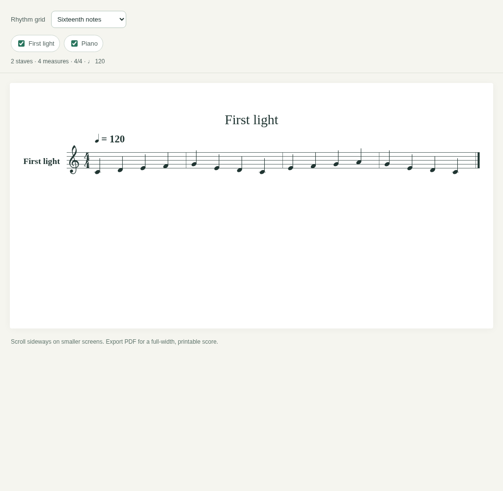

# Staves

An offline MIDI-to-sheet-music tool for the web, iPhone, and iPad. The web version needs no installation, AI model, API key, or token usage.
Built with SwiftUI, WKWebView, and a bundled ABCJS engraving engine. No server,
account, API key, subscription, or runtime package download is required.



## Use in a browser

Open **[Staves web](https://staves-midi-score.laceyshortbread.chatgpt.site)**.
The hosted Site currently requires its owner to sign in with ChatGPT.
The complete static web source is in `web/`. Import one or more `.mid`/`.midi`
files, or try **First light**.
Select parts and rhythm precision, download MusicXML, or use **导出 PDF** to open
the system print dialog and save as PDF. On iPhone, use the print preview's share
options to save the PDF. PDF export is the browser's print workflow, not a direct
PDF download.

- Files are parsed and converted on-device in a Web Worker. MIDI data is not sent
  to a server. No AI model or token billing is involved in conversion.
- The library is saved in this browser's IndexedDB. It is not synced across
  browsers or devices. Clearing site data removes it; keep the original files.
  If durable storage is unavailable, the app warns and uses session-only storage.
- Up to 10 MB per file and 50 MB total library storage. Multiple files are imported
  together; scores are opened and exported individually.
- Add the page to your phone's home screen from the browser menu. After the
  first successful load and offline cache setup, conversion works offline.
- No audio playback or AI transcription is included. This converts existing MIDI.
- The web folder bundles ABCJS and its MIT notice; the app's own code uses the
  repository's PolyForm Noncommercial license.

For local development, serve `web/` through HTTP, not `file://`:

```sh
python3 -m http.server 8080 --directory web
```

Open `http://localhost:8080`. Production requires HTTPS for offline caching and
secure-context browser APIs. The app supports a subdirectory hosting path.

## Run on iPhone or iPad

Requirements: a Mac, Xcode 15.3 or later, and iOS/iPadOS 17 or later.

1. Open **Staves.xcodeproj** in Xcode. The shared scheme is **Staves**.
2. In the Staves target's **Signing & Capabilities**, choose your Apple development
   team and replace `com.example.Staves` with a unique bundle identifier.
3. Choose an iPhone/iPad simulator or connected device and press **Run**.
4. Tap **Try a sample score**, or **Import** and select one or more `.mid` or
   `.midi` files from Files. A two-part test MIDI is also in `Tests/First-light.mid`.
5. Open a library entry to convert it. Select parts and a rhythm grid in the score
   viewer. Use **Export** to share a PDF or editable MusicXML file, or save to Files.

Importing multiple files adds them together to the library; open each score to
convert and export it. Export is per score, not a background batch-export job.
Swipe a library row to delete the app's private copy. Original imported files are
not altered. Files persist across app restarts; deleting the app removes its library.

The supplied Xcode project opens directly: no XcodeGen installation is required.
`project.yml` is an optional equivalent starting configuration for XcodeGen users.

## Included features

- Native SwiftUI library, multi-file Files import, persistent local storage,
  deletion, and a generated sample score.
- Standard MIDI formats 0 and 1, multiple tracks/channels, tempo, opening key and
  time signature, running status, chords, rests, and ties across measures.
- Overlapping notes are allocated to independent voices/staves, preserving notes
  rather than forcing different rhythms into a chord. Clefs are selected by the
  average pitch of each part.
- Eighth-, sixteenth-, or thirty-second-note quantization and per-part selection.
- Offline vector notation engraved by ABCJS, bundled with its MIT license.
- A4 PDF export through the iOS print renderer and MusicXML 4.0 export for editing
  in notation software. Share sheets support Save to Files and printing.
- File validation, conversion error messages, and warnings for unsupported MIDI
  performance information.
- GitHub Actions for MIDI engine tests and an unsigned iOS Simulator build.

## Transcription limits

MIDI stores performances, not an original engraved score. Quantization is an
approximation. This version uses a fixed grid; it does not infer tuplets, swing,
pickup measures, expressive timing, enharmonic preferences, dynamics, articulations,
or piano hand assignments. Independent voices can create more staves than the
original arrangement. MusicXML can be edited in another notation app afterward.

The opening meter, key, and tempo are used throughout. Later changes are flagged
but flattened. Sustain-pedal extensions and pitch bends are flagged and omitted.
Percussion is displayed as pitched notes with a warning, without drum-map notation.
Format 2 and SMPTE-division MIDI are rejected with an explanation.

Limits: 10 MB per imported file, 256 tracks, one million parsed events, 30,000 notes,
32 generated staves per selected score, and 1,000 measures. Select fewer parts if
a selection needs too many staves. Audio playback, recording, manual score editing,
and batch export are not included in this version.

## Source layout

- `Staves/StavesApp.swift`: app entry point.
- `Staves/Library.swift`: native library, Files import, sample generator.
- `Staves/ScoreView.swift`: WebKit bridge, score screen, PDF/MusicXML sharing.
- `Staves/Resources/engine.js`: MIDI parser, quantizer, voice allocator,
  ABC and MusicXML exporters; platform-independent and directly testable.
- `Staves/Resources/score.html`: viewer and score controls.
- `Staves/Resources/abcjs-basic-min.js`: pinned ABCJS 6.4.4, bundled offline.
- `Tests/`: MIDI fixtures and automated checks.

## Validate

The engine tests need only Node.js 22 or later:

```sh
node --test Tests/engine.test.js
```

Optional browser checks require Playwright and Chromium:

```sh
npm install
npx playwright install chromium
npm run test:browser
npm run test:web
```

The browser test uses `/usr/bin/chromium` when available, otherwise Playwright's
bundled Chromium. Set `CHROMIUM_PATH` to override. It verifies engraving without
ABC warnings, quantization controls, part filtering, an XML parse, narrow-screen
rendering, malformed-file errors, and the JavaScript/native message contract.
The iOS renderer check refreshes `Score-preview.png`. The web check covers
multi-import, IndexedDB persistence, invalid files, safe file names, offline reload,
mobile layout, deletion, XML download, and print/PDF output. CI uploads screenshots
and a sample PDF in the `web-preview-and-pdf` artifact. No browser dependencies ship in the iOS app.

On a Mac, check the native target without device signing:

```sh
xcodebuild -project Staves.xcodeproj -scheme Staves \
  -sdk iphonesimulator -destination 'generic/platform=iOS Simulator' \
  CODE_SIGNING_ALLOWED=NO build
```

**Validation:** all 11 engine tests and headless Chromium viewer checks pass.
The native iOS Simulator build also passes on GitHub's macOS runner. See the
[successful GitHub Actions run](https://github.com/LuyGGG/staves-free/actions/runs/42805725844).
The local development environment is Linux; Apple SDK compilation was performed
by CI. Physical-device execution, the native Files picker/share sheet, and native
PDF pagination still need testing on a simulator/device before release. The
screenshot shows the actual web notation component, not a running iOS simulator.

## Put it in Git

Use this directory as your repository root, so `.github/workflows` is at the root:

```sh
git init
git add .
git commit -m "Add Staves iOS MIDI notation app"
git branch -M main
git remote add origin YOUR_REPOSITORY_URL
git push -u origin main
```

If using an existing repository, copy this directory's contents, including the
hidden `.github` and `.gitignore` entries, into its root. Do not commit signing
certificates, provisioning profiles, or Xcode user data.

## License

App code is licensed under PolyForm Noncommercial 1.0.0; see `LICENSE.md`.
Commercial use is not granted by this license. Bundled ABCJS is MIT licensed; see
`Staves/Resources/ABCJS-LICENSE.md`. This is a source implementation, not a signed
App Store package. Set up signing, an app icon, and App Store metadata for release.
