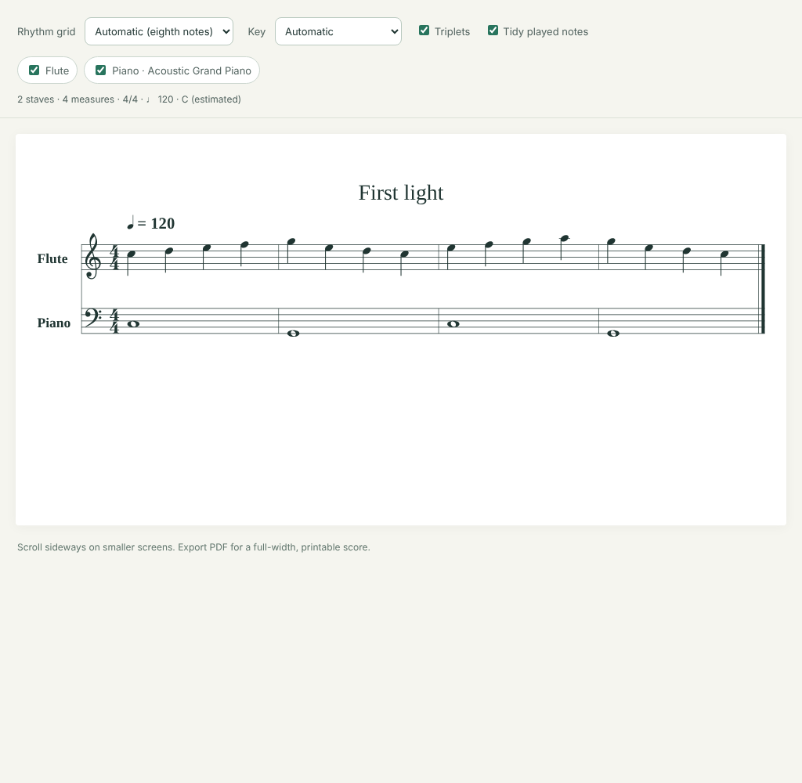

# Staves

An offline MIDI-to-sheet-music tool for the web, iPhone, and iPad. It reads a MIDI
file, recognizes the instrument of every part, and engraves a score you can print
or export. The web version needs no installation, AI model, API key, or token usage.
Built with SwiftUI, WKWebView, and a bundled ABCJS engraving engine. No server,
account, API key, subscription, or runtime package download is required.



## Use in a browser

Open **[Staves web](https://staves-midi-score.laceyshortbread.chatgpt.site)**.
The hosted Site currently requires its owner to sign in with ChatGPT.
The complete static web source is in `web/`. Import one or more `.mid`/`.midi`
files, or try **First light**.
Each part is listed with its recognized instrument. Rhythm precision is chosen
automatically; change it, the key, or the selected parts as needed, download MusicXML, or use **导出 PDF** to open
the system print dialog and save as PDF. On iPhone, use the print preview's share
options to save the PDF. PDF export is the browser's print workflow, not a direct
PDF download.

- Files are parsed and converted on-device in a Web Worker. MIDI data is not sent
  to a server. No AI model or token billing is involved in conversion.
- The library is saved in this browser's IndexedDB. It is not synced across
  browsers or devices. Clearing site data removes it; keep the original files.
  If durable storage is unavailable, the app warns and uses session-only storage.
- Up to 10 MB per file and 50 MB total library storage. Multiple files are imported
  together; scores are opened and exported individually.
- Add the page to your phone's home screen from the browser menu. After the
  first successful load and offline cache setup, conversion works offline.
- No audio playback or AI transcription is included. This converts existing MIDI;
  audio files (MP3, WAV) cannot be converted.
- The web folder bundles ABCJS and its MIT notice; the app's own code uses the
  repository's PolyForm Noncommercial license.

For local development, serve `web/` through HTTP, not `file://`:

```sh
python3 -m http.server 8080 --directory web
```

Open `http://localhost:8080`. Production requires HTTPS for offline caching and
secure-context browser APIs. The app supports a subdirectory hosting path.

## Run on iPhone or iPad

Requirements: a Mac, Xcode 15.3 or later, and iOS/iPadOS 17 or later.

1. Open **Staves.xcodeproj** in Xcode. The shared scheme is **Staves**.
2. In the Staves target's **Signing & Capabilities**, choose your Apple development
   team and replace `com.example.Staves` with a unique bundle identifier.
3. Choose an iPhone/iPad simulator or connected device and press **Run**.
4. Tap **Try a sample score**, or **Import** and select one or more `.mid` or
   `.midi` files from Files. A two-part test MIDI is also in `Tests/First-light.mid`.
5. Open a library entry to convert it. Each part is listed with its instrument.
   The rhythm grid is chosen automatically; change it or the selected parts in the
   score viewer. Use **Export** to share a PDF or editable MusicXML file, or save
   to Files.

Importing multiple files adds them together to the library; open each score to
convert and export it. Export is per score, not a background batch-export job.
Swipe a library row to delete the app's private copy. Original imported files are
not altered. Files persist across app restarts; deleting the app removes its library.

The supplied Xcode project opens directly: no XcodeGen installation is required.
`project.yml` is an optional equivalent starting configuration for XcodeGen users.

## Included features

- Native SwiftUI library, multi-file Files import, persistent local storage,
  deletion, and a generated sample score.
- Standard MIDI formats 0 and 1, multiple tracks and channels, running status,
  RIFF-wrapped (`.rmi`) files, and track names in UTF-8, GBK, or Latin-1. Damaged
  files are read as far as they are intact, with a warning.
- **Instrument recognition.** Each part is named after the General MIDI sound it
  uses (128 instruments, in English and Chinese), channel 10 is recognized as a drum
  kit, and the instrument is written into the MusicXML so notation software plays
  the right sound. A track that switches channels for another sound keeps its name
  ("Viola", "Viola · Pizzicato Strings"). See "How instruments are recognized" below.
- Time-signature, key-signature, and tempo changes during the piece. When a file
  has no key signature (or only an exporter's default C major), the key is estimated.
  The tempo printed for a measure is the one that lasts through most of it, not a
  momentary value at the bar line.
- Notes are spelled for the key (B flat in F major, G sharp in A minor) and beamed
  by the beat. Durations are split at the beat with dots and ties.
- Keyboard parts are written on a grand staff; a right-hand and a left-hand track
  are joined into one. Overlapping lines on a staff become up to four voices, so a
  held note is one long note. Viola gets an alto clef; guitars and basses get
  octave clefs. Drums are written on a five-line drum staff with cross noteheads.
- Eighth-note triplets are recognized, also when they were played slightly off
  the beat. Played (off-grid) parts are tidied: legato overlaps are removed and
  notes released slightly early are filled out.
- Automatic rhythm precision: the coarsest of the eighth-, sixteenth-, and
  thirty-second-note grids that holds the notes of the file. Any of the three can
  be chosen by hand, along with a key-signature override, switches for triplets
  and tidying, and per-part selection.
- Offline vector notation engraved by ABCJS, bundled with its MIT license.
- A4 PDF export through the iOS print renderer and MusicXML 4.0 export for editing
  in notation software. Share sheets support Save to Files and printing.
- File validation, conversion error messages, and warnings for unsupported MIDI
  performance information. Errors and warnings carry stable codes for translation.
- GitHub Actions for MIDI engine tests and an unsigned iOS Simulator build.

## How instruments are recognized

A MIDI file is a list of note events, not sound. It already says which notes are
played, so no audio analysis (such as a Fourier transform) is involved, and none
would help. The instrument is stored in the file as well, and Staves reads it in
this order:

1. The **Program Change** events on the part's channel, first in its own track,
   otherwise anywhere in the file when the file uses a single MIDI port. A part
   that switches sounds (arco and pizzicato strings) keeps the one most of its
   notes use.
2. **Channel 10** is percussion, whatever its program.
3. Without a Program Change, the **track name** ("Violin", "小提琴", "Bass").
   The part list marks these as inferred from the name.
4. Otherwise the General MIDI default, a piano, marked as the default sound.

Recognizing instruments from a recording (MP3 or WAV) is a different problem,
audio transcription, which this app does not attempt.

## Transcription limits

MIDI stores performances, not an original engraved score. Quantization is an
approximation. One grid is used for the whole conversion. Only eighth-note triplets
are inferred, in meters counted in quarter or half notes; other tuplets (sixteenth
triplets, quarter triplets), pickup measures, dynamics, articulations, slurs, and
clef changes within a part are not. A performance recorded live, without a click
or with heavy rubato, will not line up with bar lines: such a file is converted on
the sixteenth-note grid with a warning that its rhythm is approximate. MusicXML can
be edited in another notation app afterward.

Staff layout is a judgment: keyboard parts are split between the hands at middle C
unless the file has separate right-hand and left-hand tracks. Where more than four
lines overlap on a staff, the passage is written as tied chords, and in such a
passage the on-screen score can omit a tie that ABCJS has no way to draw (4 of
11,539 ties in a trial on 22 real-world files, each converted on all three grids);
the MusicXML export keeps every tie.

Sustain-pedal extensions and pitch bends are flagged and omitted. Continuous
tempo changes (rubato) are flagged, and only the opening tempo is shown. Percussion
uses the General MIDI drum map on a simplified drum staff; less common instruments
share the middle line. Format 2 and SMPTE-division MIDI are rejected with an
explanation. Guitars and basses are shown at sounding pitch under an octave clef.

Limits: 10 MB per imported file, 256 tracks, one million parsed events, 30,000 notes,
32 staves per selected score, and 1,000 measures. In the web app, a file with more
parts than fit opens with its first 16 parts selected. Audio playback, recording, manual score
editing, and batch export are not included in this version.

## Source layout

- `Staves/StavesApp.swift`: app entry point.
- `Staves/Library.swift`: native library, Files import, sample generator.
- `Staves/ScoreView.swift`: WebKit bridge, score screen, PDF/MusicXML sharing.
- `Staves/Resources/engine.js`: MIDI parser, instrument recognition, quantizer,
  staff and voice layout, ABC and MusicXML exporters; platform-independent and
  directly testable. This is the only copy to edit.
- `Staves/Resources/score.html`: viewer and score controls for the iOS app.
- `Staves/Resources/abcjs-basic-min.js`: pinned ABCJS 6.4.4, bundled offline.
- `web/`: the static web app. `web/assets/` holds copies of the engine, ABCJS, and
  the sample; `npm run sync` refreshes them and `npm run check:sync` (also run by
  CI) fails when they have drifted.
- `scripts/sync.js`: the copy and check script.
- `Tests/`: MIDI fixtures and automated checks.

When you deploy a new web version, raise `CACHE` in `web/sw.js` so browsers drop
the old offline copy. Returning visitors otherwise pick up changed files on their
second visit.

## Validate

The engine tests need only Node.js 22 or later:

```sh
npm test
```

They cover parsing, instrument recognition, rhythm, keys, staves and voices, and
both exporters. Every score built in the tests is also parsed by the bundled ABCJS,
and its ties are checked the way ABCJS pairs them. One test converts 60 random
pieces, checks that every note is written at the grid position nearest to its
start (none lost, moved, or invented), and feeds the engine 400 randomly damaged
files.

Optional browser checks require Playwright and Chromium:

```sh
npm install
npx playwright install chromium
npm run test:browser
npm run test:web
```

The browser test uses `/usr/bin/chromium` when available, otherwise Playwright's
bundled Chromium. Set `CHROMIUM_PATH` to override. It verifies engraving without
ABC warnings, instrument names, automatic and manual rhythm precision, part filtering, an XML parse,
narrow-screen rendering, malformed-file errors, and the JavaScript/native message
contract. The iOS renderer check refreshes `Score-preview.png`. The web check covers
instrument labels, key and rhythm options, multi-import, IndexedDB persistence,
invalid files, safe file names, offline reload, mobile layout, deletion, XML
download, and print/PDF output. CI uploads screenshots and a sample PDF in the
`web-preview-and-pdf` artifact. No browser dependencies ship in the iOS app.

On a Mac, check the native target without device signing:

```sh
xcodebuild -project Staves.xcodeproj -scheme Staves \
  -sdk iphonesimulator -destination 'generic/platform=iOS Simulator' \
  CODE_SIGNING_ALLOWED=NO build
```

**Validation:** the 48 engine tests and both headless-browser checks pass on Linux.
The iOS target is compiled by the `ios-build` job in GitHub Actions on every push;
it has not been run on a device. Physical-device execution, the native Files
picker/share sheet, and native PDF pagination still need testing on a
simulator/device before release. The screenshot shows the actual web notation
component, not a running iOS simulator.

## License

App code is licensed under PolyForm Noncommercial 1.0.0; see `LICENSE.md`.
Commercial use is not granted by this license. Bundled ABCJS is MIT licensed; see
`Staves/Resources/ABCJS-LICENSE.md`. This is a source implementation, not a signed
App Store package. Set up signing, an app icon, and App Store metadata for release.
